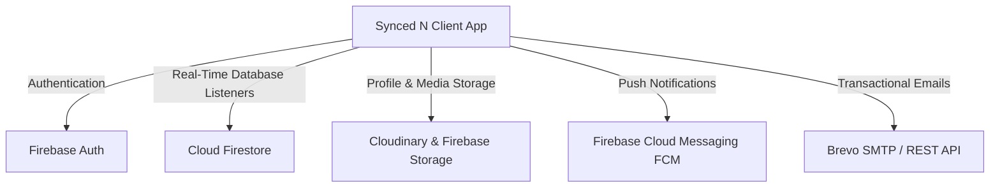

# Synced N 🎵
> **Together, in Worship, in Sync**  
> *A Real-Time Music Ministry Scheduling, Live Chord Sheet & Multi-Device Governance Platform*

---

[](https://developer.android.com/)
[](https://kotlinlang.org/)
[](https://firebase.google.com/)
[](https://gradle.org/)
[](LICENSE)

---

## 📌 Table of Contents
- [About Synced N](#-about-synced-n)
- [Key Features](#-key-features)
- [Architecture & Tech Stack](#-architecture--tech-stack)
- [Prerequisites](#-prerequisites)
- [Step-by-Step Setup Guide](#-step-by-step-setup-guide)
- [Project Directory Structure](#-project-directory-structure)
- [Security & Database Rules](#-security--database-rules)
- [Troubleshooting & FAQs](#-troubleshooting--faqs)
- [Capstone Development Team](#-capstone-development-team)

---

## 📖 About Synced N

**Synced N** is an enterprise-grade mobile application developed for church music ministries, praise & worship teams, and band ensembles. Managing a church worship ministry involves complex coordination—scheduling instrumentalists and vocalists, transposing chord sheets on the fly, managing sudden member unavailability, and ensuring seamless team leadership transitions.

Synced N provides a unified, real-time ecosystem where **Worship Leaders**, **Substitute Leaders**, and **Band Members** can collaborate with zero latency, synchronizing service lineups, chord progressions, notifications, and ministry roles across multiple Android devices simultaneously.

---

## ✨ Key Features

### 1. 🛡️ Dynamic Multi-Tier Role Governance & Real-Time Sync
- **Worship Leader Dashboard (`AdminActivity`)**: Full control over service schedules, song repertoires, announcements, roster assignments, and team settings.
- **Member Dashboard (`MemberActivity`)**: Tailored experience showing personal service assignments, upcoming lineups, announcements, and quick access to chord sheets.
- **Seamless Leadership Transitions & Leave System**: If a Worship Leader leaves the team, leadership seamlessly shifts to a designated Substitute Leader. When an original leader returns and is re-promoted, the former interim leader is gracefully demoted back to Member status with zero activity freezing or "ghost dashboard" retention.
- **Single-Leader Enforcement**: Guaranteed single source of truth in Firestore—no two users can simultaneously hold the primary Worship Leader role.

### 2. 🎼 Live Chord Sheet Viewer & Transposer
- **Instant Key Transposition**: Dynamically shift song keys (e.g., C to D, G to E) with one tap without altering the master lyrics.
- **Instrumentalist vs. Vocalist Modes**: Toggle between full chord-over-lyric notation and clean lyrics-only layout.
- **Hands-Free Auto-Scroll**: Smooth scrolling engine with customizable speeds (0.5x, 1x, 1.5x, 2x) for live stage performance.
- **Built-in Visual Metronome**: Keep team tempo tight with adjustable BPM and time signature indicators.

### 3. 📅 Service Scheduling & Song Lineups
- **Service Planner**: Create and schedule Sunday services, prayer meetings, and special events with specific dates, times, and venue locations.
- **Role Rostering**: Assign specific band members to roles (Acoustic Guitar, Bass, Keys, Drums, Lead Vocalist, Backing Vocalist).
- **Interactive Calendar**: Color-coded calendar showing upcoming services, rehearsals, and member attendance.

### 4. 🔄 Substitution & Exclusion Management
- **One-Touch Substitution Requests**: Members who are unavailable for a specific service date can request an emergency sub.
- **Availability Guard**: Prevents selecting members who have already declared unavailability for the target date, displaying real-time feedback and blocking invalid requests.
- **Leader Approval Pipeline**: Worship Leaders receive push and in-app notifications to review, approve, or reject substitutions instantly.

### 5. 📢 Urgent Alerts, Announcements & Rejoin Requests
- **Urgent Notices**: Broadcast high-priority church alerts directly to the team dashboard with sticky highlight banners.
- **Cloud Messaging (FCM)**: Push notifications delivered in real-time when new services are published or lineups change.
- **Membership Approval System**: Prospective members request entry using unique team codes (`KPA...`), with leader approval verification.

---

## 🛠 Architecture & Tech Stack



- **Language**: Kotlin 1.9.22
- **Architecture**: MVVM / Clean Repository Pattern with Realtime Reactive Observers
- **UI Toolkit**: Android Views, Material Design 3, ConstraintLayout, Dynamic Ripple / Glassmorphism Effects
- **Backend & Persistence**:
  - Google Cloud Firestore (Real-time snapshots, transactions, compound queries)
  - Firebase Authentication (Google Sign-In + Email/Password)
  - Firebase Cloud Messaging (FCM)
  - Android Encrypted SharedPreferences (`SessionManager`)
- **Third-Party Integrations**:
  - Cloudinary Android SDK (Profile image optimization & upload presets)
  - Brevo (Sendinblue) API (Automated email notifications & alerts)

---

## 📋 Prerequisites

Before setting up the project, ensure your development workstation meets the following requirements:

1. **Android Studio**: Android Studio Hedgehog (2023.1.1) or newer (Jellyfish / Koala recommended).
2. **JDK**: Java Development Kit 17 (OpenJDK 17 recommended).
3. **Android SDK**:
   - `compileSdk`: 34
   - `targetSdk`: 34
   - `minSdk`: 24 (Android 7.0 Nougat or higher)
4. **Git**: Installed and configured on your machine.
5. **Firebase Project**: An active Firebase project with Firestore and Auth enabled, with `google-services.json` placed inside `/app`.

---

## 🚀 Step-by-Step Setup Guide

### 1. Clone the Repository
Open your terminal (PowerShell, Bash, or Command Prompt) and run:
```bash
git clone https://github.com/RyKhaan/Synced-N.git
cd Synced-N
```

### 2. Configure Environment Variables
Copy the template `.env.example` file to create your local `.env`:
```bash
# On Windows (PowerShell):
Copy-Item .env.example .env

# On macOS/Linux:
cp .env.example .env
```
Open `.env` in a text editor and supply your credentials:
```env
BREVO_API_KEY=your_brevo_api_key_here
BREVO_SENDER_EMAIL=your_verified_sender@email.com
CLOUDINARY_CLOUD_NAME=your_cloudinary_cloud_name
CLOUDINARY_UPLOAD_PRESET=your_upload_preset
```

### 3. Add Firebase Configuration
Download your `google-services.json` file from the [Firebase Console](https://console.firebase.google.com/):
- Place the file in the following path:
  ```text
  Synced1.0/
  └── app/
      └── google-services.json
  ```

### 4. Open and Sync Project in Android Studio
1. Launch **Android Studio**.
2. Select **File > Open...** and navigate to the cloned `Synced1.0` folder.
3. Allow Gradle to download dependencies and sync the project.
4. Verify that Android Studio is using **JDK 17** under:  
   `Settings > Build, Execution, Deployment > Build Tools > Gradle > Gradle JDK`.

### 5. Run Unit Tests
To verify project integrity before deployment, execute all automated unit tests:
```bash
# On Windows:
.\gradlew.bat testDebugUnitTest

# On macOS/Linux:
./gradlew testDebugUnitTest
```
*(All 140+ unit tests should pass successfully).*

### 6. Build and Install on Device / Emulator
Connect an Android device with **USB Debugging** enabled or start an **Android Virtual Device (AVD)**, then run:
```bash
# Build & install debug APK directly:
.\gradlew.bat installDebug

# Or build the APK package:
.\gradlew.bat assembleDebug
```
The compiled APK will be located at:
`app/build/outputs/apk/debug/app-debug.apk`

---

## 📂 Project Directory Structure

```text
Synced-N/
├── app/
│   ├── src/
│   │   ├── main/
│   │   │   ├── java/com/example/syncedn/
│   │   │   │   ├── AdminActivity.kt          # Worship Leader Dashboard & Management
│   │   │   │   ├── MemberActivity.kt         # Band Member Dashboard & Views
│   │   │   │   ├── LoginActivity.kt          # Firebase Authentication Entrypoint
│   │   │   │   ├── ChordSheetActivity.kt     # Live Transposition & Chord Viewer
│   │   │   │   ├── data/
│   │   │   │   │   ├── auth/                 # AuthManager, SessionManager, FCM Service
│   │   │   │   │   ├── database/             # FirestoreManager, TeamRepository
│   │   │   │   │   └── model/                # Data models (Service, Song, Member, etc.)
│   │   │   │   └── utils/                    # ChordParser, Metronome, Notifications
│   │   │   └── res/                          # Layouts, Drawables, Values & Navigation
│   │   └── test/                             # 140+ Comprehensive Unit Tests
│   ├── build.gradle.kts                      # Module-level Gradle configuration
│   └── google-services.json                  # Firebase configuration file
├── .env.example                              # Environment variables template
├── firestore.rules                           # Production Cloud Firestore Security Rules
├── gradlew.bat / gradlew                     # Gradle Wrapper scripts
├── build.gradle.kts                          # Root project Gradle configuration
└── README.md                                 # Project documentation
```

---

## 🔒 Security & Database Rules

Synced N utilizes granular, least-privilege security policies defined in [`firestore.rules`](file:///c:/Users/RYAN/AndroidStudioProjects/Synced1.0/firestore.rules).
- **Roster & Team Governance**: Only authorized team leaders can modify team names, promote sub-leaders, or accept re-join requests.
- **Substitution Integrity**: Members can only modify substitution records that pertain to their own assignments.
- **Account Protection**: Users cannot overwrite another user's authentication profile or elevate their own privileges.

---

## 💡 Troubleshooting & FAQs

### Q1: The Emulator feels laggy or transitions are slow.
- In Android Studio, go to **Virtual Device Manager > Edit Device > Advanced Settings > Graphics**. Set Graphics to **Hardware - GLES 2.0**.
- Allocate at least **4 GB RAM** and **4 CPU cores** to the emulator.

### Q2: Why is my dashboard not updating when a leader promotes or demotes me?
- Synced N listens directly to Firestore snapshots in real time. Ensure your test device has internet access and Google Play Services enabled. The app immediately detects role transitions and seamlessly swaps between `AdminActivity` and `MemberActivity`.

### Q3: Where do I get an updated APK?
- The latest tested debug APK is generated under `build/releases/SyncedN-v1.0-debug.apk` and copied to `Synced_N.apk` in the project root.

---

## 👥 Capstone Development Team

Developed as a Capstone Project for **ICCT Colleges - Cainta Main Campus**:

| Name | Role | Responsibilities |
| :--- | :--- | :--- |
| **Ryan Lloyd Genturo** | Project Lead / Full-Stack Developer | System Architecture, Real-Time Sync, Multi-Device Governance |
| **John Michael Ramirez** | Frontend & UI/UX Developer | Responsive Layouts, Chord Transposer & Musician Experience |
| **Joshua Lagare** | Backend & DevOps Engineer | Firebase Infrastructure, Firestore Rules, Cloud Messaging |

---

*Together, in Worship, in Sync.*
