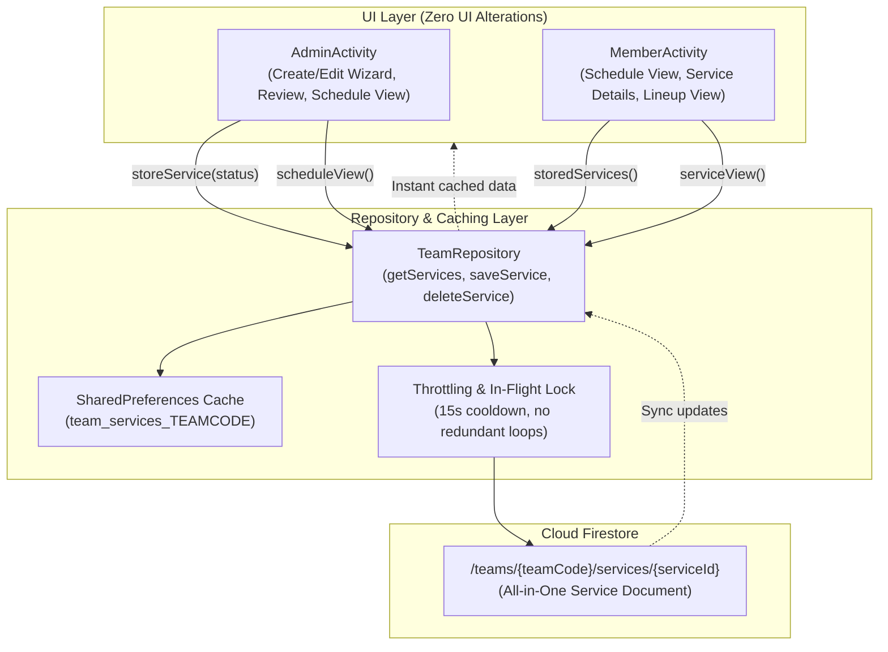

# Design Spec: Group 3 — Worship Services, Schedules, Role Assignments & Rehearsals

**Date:** 2026-10-18  
**Status:** Approved by User / Ready for Implementation Plan  
**Package:** `com.example.syncedn.data` and `com.example.syncedn`  
**Target Branch:** `Backend`

---

## 1. Overview & Objective

Sa kasalukuyang implementasyon ng Synced N:
- Sa `AdminActivity.kt`, ang paggawa ng Worship Service (`storeService()`) ay nagse-save lamang sa local `SharedPreferences` (`preferences.getString("leaderServices", "[]")`). Kapag nag-publish ang Leader sa kanyang device, hindi ito nakakarating sa Cloud Firestore at hindi nakikita ng mga miyembro sa kanilang sariling phone o emulator.
- Sa `MemberActivity.kt`, ang `scheduleView()` at `serviceView()` ay gumagamit ng hardcoded sample services kapag walang local data, at ang *"Assigned Members and their Roles"* ay naka-hardcode sa `ministryMembers.take(4)`.
- Kapag nag-palit ng device o nag-log in ang mga collaborators, laging walang laman ang schedule dahil walang live database synchronization.

### Pangunahing Layunin (Group 3 Goals):
1. **Firestore Subcollection Architecture:**
   I-save at i-synchronize ang lahat ng Worship Services sa Cloud Firestore subcollection:
   `/teams/{teamCode}/services/{serviceId}`
2. **All-in-One Service Document Model:**
   Ang bawat service document ay naglalaman ng kumpletong impormasyon:
   - Pangunahing detalye: Title, Date, Start/End Time, Venue, Status (`"Draft"` o `"Published"`).
   - Team Assignments: Listahan ng mga miyembro at kanilang ministry role para sa service na iyon.
   - Rehearsal Details: Petsa, oras, venue, at karagdagang paalala/notes para sa ensayo.
   - Song Lineup: Mga napiling awitin mula sa song catalog.
3. **Role-Based Visibility:**
   - **Members:** Makikita lamang ang mga services na may status na `"Published"`.
   - **Leader:** Makikita ang parehong `"Draft"` at `"Published"` services, at may kakayahang mag-edit, mag-publish, at magbura.
4. **Strict Zero UI Disruption:**
   Walang anumang layout, styling, colors, o existing UI components ang babaguhin o aalisin. Ang live backend data ay ikakabit sa likod ng kasalukuyang screen flow.
5. **Offline Resiliency & Lag Prevention:**
   Multi-level caching sa `SharedPreferences` (`team_services_<teamCode>`), in-flight request deduplication, at 15-second debounce/throttling sa `TeamRepository` upang manatiling 60 FPS at walang frame drops.

---

## 2. Architecture & Data Flow



---

## 3. Data Models (`com.example.syncedn.data.model`)

### 3.1 `ServiceData.kt`
```kotlin
package com.example.syncedn.data.model

data class ServiceData(
    val id: String = "",
    val teamCode: String = "",
    val title: String = "",
    val date: String = "",              // "YYYY-MM-DD"
    val start: String = "",             // "HH:mm"
    val end: String = "",               // "HH:mm"
    val venue: String = "",
    val status: String = "Draft",       // "Draft" or "Published"
    val assignments: List<ServiceAssignment> = emptyList(),
    val rehearsal: RehearsalData = RehearsalData(),
    val songs: List<ServiceSong> = emptyList(),
    val createdBy: String = "",         // Leader UID
    val createdAt: Long = System.currentTimeMillis(),
    val updatedAt: Long = System.currentTimeMillis()
) {
    fun toMap(): Map<String, Any> = mapOf(
        "id" to id,
        "teamCode" to teamCode,
        "title" to title,
        "date" to date,
        "start" to start,
        "end" to end,
        "venue" to venue,
        "status" to status,
        "assignments" to assignments.map { it.toMap() },
        "rehearsal" to rehearsal.toMap(),
        "songs" to songs.map { it.toMap() },
        "createdBy" to createdBy,
        "createdAt" to createdAt,
        "updatedAt" to updatedAt
    )

    companion object {
        fun fromMap(map: Map<String, Any?>): ServiceData {
            val assignmentsList = (map["assignments"] as? List<*>)?.mapNotNull { item ->
                (item as? Map<String, Any?>)?.let { ServiceAssignment.fromMap(it) }
            } ?: emptyList()

            val songsList = (map["songs"] as? List<*>)?.mapNotNull { item ->
                (item as? Map<String, Any?>)?.let { ServiceSong.fromMap(it) }
            } ?: emptyList()

            val rehearsalMap = map["rehearsal"] as? Map<String, Any?> ?: emptyMap()

            return ServiceData(
                id = map["id"] as? String ?: "",
                teamCode = map["teamCode"] as? String ?: "",
                title = map["title"] as? String ?: "",
                date = map["date"] as? String ?: "",
                start = map["start"] as? String ?: "",
                end = map["end"] as? String ?: "",
                venue = map["venue"] as? String ?: "",
                status = map["status"] as? String ?: "Draft",
                assignments = assignmentsList,
                rehearsal = RehearsalData.fromMap(rehearsalMap),
                songs = songsList,
                createdBy = map["createdBy"] as? String ?: "",
                createdAt = (map["createdAt"] as? Number)?.toLong() ?: System.currentTimeMillis(),
                updatedAt = (map["updatedAt"] as? Number)?.toLong() ?: System.currentTimeMillis()
            )
        }
    }
}

data class ServiceAssignment(
    val uid: String = "",
    val email: String = "",
    val name: String = "",
    val role: String = ""
) {
    fun toMap(): Map<String, Any> = mapOf(
        "uid" to uid,
        "email" to email,
        "name" to name,
        "role" to role
    )

    companion object {
        fun fromMap(map: Map<String, Any?>): ServiceAssignment = ServiceAssignment(
            uid = map["uid"] as? String ?: "",
            email = map["email"] as? String ?: "",
            name = map["name"] as? String ?: "",
            role = map["role"] as? String ?: ""
        )
    }
}

data class RehearsalData(
    val date: String = "",
    val start: String = "",
    val end: String = "",
    val venue: String = "",
    val notes: String = ""
) {
    fun toMap(): Map<String, Any> = mapOf(
        "date" to date,
        "start" to start,
        "end" to end,
        "venue" to venue,
        "notes" to notes
    )

    companion object {
        fun fromMap(map: Map<String, Any?>): RehearsalData = RehearsalData(
            date = map["date"] as? String ?: "",
            start = map["start"] as? String ?: "",
            end = map["end"] as? String ?: "",
            venue = map["venue"] as? String ?: "",
            notes = map["notes"] as? String ?: ""
        )
    }
}

data class ServiceSong(
    val title: String = "",
    val artist: String = "",
    val key: String = "",
    val bpm: Int = 0
) {
    fun toMap(): Map<String, Any> = mapOf(
        "title" to title,
        "artist" to artist,
        "key" to key,
        "bpm" to bpm
    )

    companion object {
        fun fromMap(map: Map<String, Any?>): ServiceSong = ServiceSong(
            title = map["title"] as? String ?: "",
            artist = map["artist"] as? String ?: "",
            key = map["key"] as? String ?: "",
            bpm = (map["bpm"] as? Number)?.toInt() ?: 0
        )
    }
}
```

---

## 4. Repository Implementation (`TeamRepository.kt`)

Idaragdag sa `TeamRepository`:
1. **`getServices(teamCode: String, isLeader: Boolean, preferences: SharedPreferences, onComplete: (Result<List<ServiceData>>) -> Unit)`**
   - Agad na nagbabalik ng cached services mula sa `team_services_<teamCode>`.
   - Gumagamit ng `servicesInFlight` boolean at `lastServicesFetchTimes` (15s cooldown) upang pigilan ang redundant network spam.
   - Naka-scope ang query sa `/teams/{teamCode}/services`.
   - Kapag `isLeader == false`, nag-a-apply ng query filter: `.whereEqualTo("status", "Published")`.
   - Ina-update ang local cache pagkatapos ng successful fetch.
2. **`saveService(teamCode: String, service: ServiceData, preferences: SharedPreferences, onComplete: ((Result<ServiceData>) -> Unit)? = null)`**
   - Agad na isinusulat sa local cache upang instant ang UI transition.
   - Gumagawa ng background Firestore write gamit ang `set(service.toMap(), SetOptions.merge())`.
3. **`deleteService(teamCode: String, serviceId: String, preferences: SharedPreferences, onComplete: ((Result<Boolean>) -> Unit)? = null)`**
   - Inaalis sa local cache at bina-background delete sa Firestore.

---

## 5. UI Integration Details

### 5.1 Leader (`AdminActivity.kt`)
- **`storeService(status: String)`:**
  - Binubuo ang `ServiceData` mula sa `leaderDraft` (kabilang ang `draftAssignments`, rehearsal details, at song lineup).
  - Tinatawag ang `TeamRepository.saveService(teamCode, serviceData, preferences)`.
  - Nananatili ang toast at instant navigation patungo sa `"schedule"`.
- **`scheduleView()`:**
  - Kinukuha ang services gamit ang `TeamRepository.getServices(teamCode, isLeader = true, preferences)`.
  - Isinasalansan ang mga cards gamit ang kasalukuyang format (Upcoming vs Past, status badge, at click listener).
- **Service Details (`leaderServiceView`):**
  - Ipinapakita ang live service metadata, assignments, at lineup.

### 5.2 Member (`MemberActivity.kt`)
- **`storedServices()`:**
  - Kinukuha ang mga services mula sa `TeamRepository.getServices(teamCode, isLeader = false, preferences)`.
- **`scheduleView()`:**
  - Nagpapakita ng mga tunay na Published services para sa team.
  - Panatilihin ang purple date box, oras, title, at click navigation papunta sa `"service"`.
- **`serviceView()`:**
  - Dynamic rendering ng selected service: Title, Date, Time, Venue.
  - Ang listahan sa ilalim ng *"Assigned Members and their Roles"* ay nagmumula sa totoong `assignments` ng naturang service.
  - Ang *"Song Lineups"* ay nagbubukas ng totoong lineup songs ng naturang service.

---

## 6. Cloud Firestore Security Rules (`firestore.rules`)

Idaragdag sa ilalim ng `match /teams/{teamCode}`:
```javascript
// Subcollection: /teams/{teamCode}/services/{serviceId}
match /services/{serviceId} {
  // Read Permission:
  // - Authenticated team members can read Published services.
  // - Team Leader can read both Draft and Published services.
  allow read: if isAuthenticated() && isSameTeam(teamCode) && (
    isLeaderOfTeam(teamCode) ||
    (resource != null && resource.data.status == 'Published')
  );

  // Write Permission:
  // - Team Leader only can create, update, or delete services.
  allow create: if isLeaderOfTeam(teamCode) &&
                   isValidService(request.resource.data, serviceId, teamCode) &&
                   request.resource.data.createdBy == request.auth.uid;

  allow update: if isLeaderOfTeam(teamCode) &&
                   isValidService(request.resource.data, serviceId, teamCode) &&
                   areImmutableFieldsUnchanged(['id', 'teamCode', 'createdBy', 'createdAt']);

  allow delete: if isLeaderOfTeam(teamCode);
}
```

At ang validator:
```javascript
function isValidService(data, serviceId, teamCode) {
  return hasOnlyAllowedFields(data, [
    'id', 'teamCode', 'title', 'date', 'start', 'end', 'venue',
    'status', 'assignments', 'rehearsal', 'songs', 'createdBy',
    'createdAt', 'updatedAt'
  ]) &&
  hasRequiredFields(data, ['id', 'teamCode', 'title', 'date', 'start', 'end', 'venue', 'status', 'createdBy']) &&
  data.id is string && data.id == serviceId &&
  data.teamCode is string && data.teamCode == teamCode &&
  data.title is string && data.title.size() > 0 && data.title.size() <= 100 &&
  data.date is string && data.date.size() <= 20 &&
  data.start is string && data.start.size() <= 10 &&
  data.end is string && data.end.size() <= 10 &&
  data.venue is string && data.venue.size() > 0 && data.venue.size() <= 100 &&
  data.status is string && data.status in ['Draft', 'Published'] &&
  (!('assignments' in data) || (data.assignments is list && data.assignments.size() <= 50)) &&
  (!('rehearsal' in data) || data.rehearsal is map) &&
  (!('songs' in data) || (data.songs is list && data.songs.size() <= 50)) &&
  data.createdBy is string && data.createdBy.size() > 0 &&
  (!('createdAt' in data) || (data.createdAt is number && data.createdAt >= 0) || (data.createdAt is timestamp)) &&
  (!('updatedAt' in data) || (data.updatedAt is number && data.updatedAt >= 0) || (data.updatedAt is timestamp));
}
```

---

## 7. Verification & Testing Strategy

1. **Unit Testing (`ExampleUnitTest.kt`):**
   - `testServiceDataSerializationAndDeserialization`: Sinusubok ang buong `toMap()` at `fromMap()` kasama ang assignments, rehearsal, at songs.
   - `testTeamRepositoryServiceCachingAndThrottling`: Sinusubok ang cache storage at 15-second debounce.
   - `testPublishedServicesFilteringForMembers`: Sinusubok na tanging `"Published"` services ang nakikita ng regular members.
2. **Build & Static Analysis:**
   - `./gradlew.bat compileDebugSources`
   - `./gradlew.bat testDebugUnitTest` (dapat 100% passing).
3. **Live Emulator Testing (`emulator-5554`):**
   - **Leader Flow:** Lumikha ng Bagong Service (Title, Date, Time, Venue, Assignments, Lineup, Rehearsal), i-publish, at i-verify sa Leader Schedule view.
   - **Member Flow:** Mag-log in bilang Member, buksan ang Schedule, i-verify na lumitaw ang bagong Published service, i-click ito, at tingnan ang tamang Assigned Members at Lineup.
