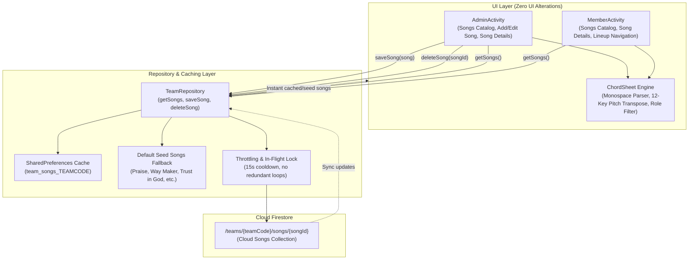

# Design Spec: Group 4 — Songs Library & Chord/Lyrics Sheets

**Date:** 2026-10-18  
**Status:** Approved by User / Ready for Implementation Plan  
**Package:** `com.example.syncedn.data` and `com.example.syncedn`  
**Target Branch:** `Backend`

---

## 1. Overview & Objective

Sa kasalukuyang implementasyon ng Synced N:
- Sa `AdminActivity.kt` at `MemberActivity.kt`, ang `songsView()` ay gumagamit lamang ng hardcoded in-memory list:
  `listOf("Praise" to "Elevation Worship", "Trust in God" to "Elevation Worship", "Way Maker" to "Sinach", "Gratitude" to "Brandon Lake")`.
- Ang mga kanta at ang kani-kanilang chord sheets ay nakalagay lamang sa pansamantalang local SharedPreferences (`songData_$selectedSong`), kaya:
  1. Hindi naipapasa o nase-save sa Cloud Firestore ang mga kanta.
  2. Kapag nagdagdag o nag-edit ang Worship Leader ng bagong kanta, liriko, o chord sheet, hindi ito nakikita ng mga miyembro ng ministry sa kanilang mga device.
  3. Kapag nagpalit ng device o nag-reinstall ng app, nawawala ang mga na-edit na kanta.
- Sa `AdminActivity.kt`, ang `songEditView()` ay nagse-save lamang sa local preferences at hindi nakakabit sa live Firestore database.

### Pangunahing Layunin (Group 4 Goals):
1. **Cloud Firestore Subcollection Architecture:**
   I-save at i-synchronize ang buong catalog ng mga awitin ng ministry sa:
   `/teams/{teamCode}/songs/{songId}`
2. **Comprehensive Song & Chord Sheet Model (`SongData`):**
   Ang bawat kanta ay may kumpletong impormasyon:
   - Metadata: `id`, `teamCode`, `title`, `artist`, `key` (original key, e.g., "C", "G", "F#m"), `bpm` (tempo).
   - Content: `sheet` (chord sheet na may bracketed notation, hal. `[C]`, `[Am]`, `[G]`), `lyrics` (malinis na lyrics para sa mga vocalists), `referenceUrl` (link sa YouTube video o audio recording).
   - Audit: `createdBy` (Leader UID), `createdAt`, `updatedAt`.
3. **Multi-Tier Caching & Offline Resiliency:**
   - Offline fallback gamit ang `SharedPreferences` cache key: `team_songs_<teamCode>`.
   - In-memory debouncing (15-segundong cooldown katulad ng services) at in-flight request deduplication upang maiwasan ang redundant reads sa Firestore at matiyak ang smooth 60 FPS scrolling.
   - Built-in Seed Catalog: Kung bagong gawa ang team at wala pang custom songs sa Firestore, awtomatikong maglo-load ang standard worship seed songs (*Praise, Trust in God, Way Maker, Gratitude, Goodness of God, Build My Life, Amazing Grace*) upang hindi maging blanko ang library.
4. **Role-Adaptive Chord & Lyrics Display:**
   - **Instrumentalists** (Musicians, Guitarists, Keyboardists, Bassists, Drummers): Makikita ang formatted Monospace Chords sa ibabaw ng lyrics, kasama ang interactive 12-key Transposition Engine.
   - **Vocalists / Others:** Makikita ang malinis na lyrics lang nang walang nakalilitong chords.
5. **Strict Zero UI Disruption & Layout Integrity:**
   - Panatilihin ang lahat ng kasalukuyang kulay, typography, padding, at widget structures.
   - Panatilihin ang naayos na 6dp margins sa transpose buttons at 8dp margins sa tabs para sa maayos at propesyonal na visual breathing room.
6. **Robust Firestore Security Rules:**
   - Validation gamit ang `isValidSong()` function.
   - Read access para sa lahat ng lehitimong miyembro ng parehong team (`isSameTeam(teamCode)`).
   - Create, Update, Delete access na eksklusibo lamang para sa verified Team Leader (`isLeaderOfTeam(teamCode)`).

---

## 2. Architecture & Data Flow



---

## 3. Data Model (`com.example.syncedn.data.model.SongData`)

### 3.1 `SongData.kt`
```kotlin
package com.example.syncedn.data.model

data class SongData(
    val id: String = "",
    val teamCode: String = "",
    val title: String = "",
    val artist: String = "",
    val key: String = "C",
    val bpm: Int = 74,
    val sheet: String = "",
    val lyrics: String = "",
    val referenceUrl: String = "",
    val createdBy: String = "",
    val createdAt: Long = System.currentTimeMillis(),
    val updatedAt: Long = System.currentTimeMillis()
) {
    fun toMap(): Map<String, Any> = mapOf(
        "id" to id,
        "teamCode" to teamCode,
        "title" to title,
        "artist" to artist,
        "key" to key,
        "bpm" to bpm,
        "sheet" to sheet,
        "lyrics" to lyrics,
        "referenceUrl" to referenceUrl,
        "createdBy" to createdBy,
        "createdAt" to createdAt,
        "updatedAt" to updatedAt
    )

    companion object {
        fun fromMap(map: Map<String, Any?>): SongData {
            return SongData(
                id = map["id"] as? String ?: "",
                teamCode = map["teamCode"] as? String ?: "",
                title = map["title"] as? String ?: "",
                artist = map["artist"] as? String ?: "",
                key = (map["key"] as? String)?.ifBlank { "C" } ?: "C",
                bpm = when (val b = map["bpm"]) {
                    is Number -> b.toInt()
                    is String -> b.toIntOrNull() ?: 74
                    else -> 74
                },
                sheet = map["sheet"] as? String ?: "",
                lyrics = map["lyrics"] as? String ?: "",
                referenceUrl = map["referenceUrl"] as? String ?: "",
                createdBy = map["createdBy"] as? String ?: "",
                createdAt = (map["createdAt"] as? Number)?.toLong() ?: System.currentTimeMillis(),
                updatedAt = (map["updatedAt"] as? Number)?.toLong() ?: System.currentTimeMillis()
            )
        }
    }
}
```

---

## 4. Firestore Security Rules Specification

I-a-update ang `firestore.rules` sa pamamagitan ng pagdagdag ng validator function na `isValidSong()` at ang subcollection match rule sa ilalim ng `/teams/{teamCode}`:

### 4.1 Validator Function
```javascript
function isValidSong(data, songId, teamCode) {
  return hasRequiredFields(data, ['id', 'teamCode', 'title', 'key', 'createdBy', 'createdAt', 'updatedAt']) &&
    hasOnlyAllowedFields(data, [
      'id', 'teamCode', 'title', 'artist', 'key', 'bpm', 'sheet', 'lyrics',
      'referenceUrl', 'createdBy', 'createdAt', 'updatedAt'
    ]) &&
    data.id == songId &&
    validStringLength(data.id, 1, 64) &&
    data.teamCode == teamCode &&
    isValidTeamCode(data.teamCode) &&
    validStringLength(data.title, 1, 120) &&
    (!('artist' in data) || validStringLength(data.artist, 0, 100)) &&
    validStringLength(data.key, 1, 10) &&
    (!('bpm' in data) || data.bpm is number || (data.bpm is string && data.bpm.size() <= 10)) &&
    (!('sheet' in data) || validStringLength(data.sheet, 0, 30000)) &&
    (!('lyrics' in data) || validStringLength(data.lyrics, 0, 20000)) &&
    (!('referenceUrl' in data) || data.referenceUrl == '' || isValidUrl(data.referenceUrl)) &&
    validStringLength(data.createdBy, 1, 128) &&
    (data.createdAt is number || data.createdAt is timestamp) &&
    (data.updatedAt is number || data.updatedAt is timestamp);
}
```

### 4.2 Subcollection Rule
```javascript
match /teams/{teamCode} {
  ...
  // Subcollection: Songs (/teams/{teamCode}/songs/{songId})
  match /songs/{songId} {
    allow read: if isAuthenticated() && isSameTeam(teamCode);

    allow create: if isLeaderOfTeam(teamCode) &&
                     isValidSong(request.resource.data, songId, teamCode) &&
                     request.resource.data.createdBy == request.auth.uid;

    allow update: if isLeaderOfTeam(teamCode) &&
                     isValidSong(request.resource.data, songId, teamCode) &&
                     areImmutableFieldsUnchanged(['id', 'teamCode', 'createdBy', 'createdAt']);

    allow delete: if isLeaderOfTeam(teamCode);
  }
}
```

---

## 5. Repository & Caching Layer (`TeamRepository.kt`)

### 5.1 Mga Bagong Method sa `TeamRepository`
1. **`getSongs(teamCode: String, forceRefresh: Boolean = false, onResult: (List<SongData>) -> Unit)`**
   - Agad na ibinabalik ang cached songs mula sa `getCachedSongs(teamCode)`.
   - Kung walang cached songs, ibinabalik ang `getDefaultSeedSongs(teamCode)`.
   - Nag-che-check ng debounce cooldown (15 segundo) bago mag-fetch sa Firestore:
     `firestore.collection("teams").document(teamCode).collection("songs").orderBy("title")`.
   - Kapag nag-tagumpay ang Firestore query:
     - I-save ang listahan sa local cache (`team_songs_<teamCode>`).
     - I-deliver ang updated list sa `onResult`.
   - Kapag nag-fail o offline, tahimik na mananatili sa cached/seed data nang walang crash o error toast.
2. **`saveSong(teamCode: String, song: SongData, onComplete: (Boolean, String?) -> Unit)`**
   - Agad na ina-update ang local cache (optimistic update).
   - Isinusulat sa Firestore `/teams/{teamCode}/songs/{song.id}` gamit ang `set(song.toMap(), SetOptions.merge())`.
   - Nagbabalik ng `(true, null)` sa tagumpay o `(false, errorMsg)` kapag nagkaproblema.
3. **`deleteSong(teamCode: String, songId: String, onComplete: (Boolean, String?) -> Unit)`**
   - Agad na tinatanggal sa local cache.
   - Binubura sa Firestore `/teams/{teamCode}/songs/{songId}` gamit ang `delete()`.
4. **`getDefaultSeedSongs(teamCode: String): List<SongData>`**
   - Nagbabalik ng default list ng worship songs na may tamang key, tempo, at sample chord sheets para magamit agad ng anumang bagong team:
     - *Praise* (Elevation Worship, Key C, 74 BPM)
     - *Trust in God* (Elevation Worship, Key C, 74 BPM)
     - *Way Maker* (Sinach, Key C, 74 BPM)
     - *Gratitude* (Brandon Lake, Key B, 78 BPM)
     - *Goodness of God* (Bethel Music, Key Ab, 70 BPM)
     - *Build My Life* (Pat Barrett, Key G, 68 BPM)
     - *Amazing Grace* (John Newton, Key G, 72 BPM)

---

## 6. UI & Screen Integration

### 6.1 `AdminActivity.kt`
- **`songsView()`**:
  - Nagtatawag ng `TeamRepository.getSongs(teamCode)` upang dynamic na i-populate ang listahan.
  - Search bar na nagfi-filter sa listahan nang real-time habang nagta-type.
  - Floating Action Button o "+ Add Song" header action para buksan ang `songEditView`.
  - Bawat song card ay may click listener papunta sa `songDetailsView`.
- **`songEditView()`**:
  - Input fields para sa Title, Artist, Key (picker o dropdown), BPM, Reference URL, at Lyrics/Chords sheet editor.
  - Pag-click sa "Save Song":
    - Lumilikha o nag-a-update ng `SongData`.
    - Tumatawag sa `TeamRepository.saveSong(teamCode, song)`.
    - Nag-n-navigate pabalik sa `songsView` na may updated list.
  - Option para sa "Delete Song" na may confirmation dialog.
- **`songDetailsView()`**:
  - Kumukuha ng `SongData` mula sa repository cache.
  - Nagbibigay ng "Edit Song" button para sa Leader.
  - Monospace lyrics & chords display gamit ang `ChordSheet.render()`.
  - Transpose buttons na may naayos na 6dp margins at active key highlight.

### 6.2 `MemberActivity.kt`
- **`songsView()`**:
  - Nagtatawag ng `TeamRepository.getSongs(teamCode)`.
  - Real-time search para madaling makita ng miyembro ang mga awitin.
- **`songDetailsView()`**:
  - Kumukuha ng kanta mula sa repository.
  - Role-adaptive rendering:
    - Instrumentalists: Lyrics & Chords sheet + Transpose preview.
    - Vocalists: Plain Lyrics sheet lamang.
- **`lineupView()`**:
  - Ang pag-tap sa alinmang kanta sa lineup ng isang Worship Service ay awtomatikong magbubukas ng kaukulang kanta sa `songDetailsView` gamit ang service target key.

---

## 7. Testing Strategy

1. **Model & Serialization Tests (`ExampleUnitTest.kt`):**
   - `testSongDataSerializationAndDeserialization()`: Tinitiyak na ang lahat ng fields (kabilang ang `sheet`, `lyrics`, `bpm`, `referenceUrl`, at timestamps) ay tama ang pagkaka-map sa `toMap()` at `fromMap()`.
2. **Repository Caching & Seed Fallback Tests (`ExampleUnitTest.kt`):**
   - `testTeamRepositorySongCachingAndSeedFallback()`: Tinitiyak na kapag walang data sa Firestore o offline, maayos na ibinabalik ang seed catalog at local cache.
   - `testTeamRepositorySongOptimisticUpdate()`: Tinitiyak na ang pag-save o pagbura ng kanta ay agad na sumasalamin sa local cache nang walang latency.
3. **ChordSheet Transposition & Role Tests:**
   - Sinusuri ang tamang pag-transpose ng mga chords sa iba't ibang pitch (C -> D -> Eb).
   - Sinusuri ang instrumentalist vs vocalist filtering.
4. **End-to-End Build & Visual Verification:**
   - `./gradlew.bat compileDebugSources`
   - `./gradlew.bat testDebugUnitTest`
   - Live emulator run para kumpirmahin ang paggana ng catalog, search, add song, at transpose engine.

---

## 8. Acceptance Criteria

- [ ] May data model na `SongData` na may buong `toMap()` at `fromMap()`.
- [ ] Ang `firestore.rules` ay may updated `isValidSong()` at `/teams/{teamCode}/songs/{songId}` rules.
- [ ] May kumpletong CRUD at caching methods sa `TeamRepository.kt` (`getSongs`, `saveSong`, `deleteSong`).
- [ ] Ang `AdminActivity.kt` ay may dynamic `songsView`, gumaganang `songEditView` para sa add/edit/delete, at dynamic `songDetailsView`.
- [ ] Ang `MemberActivity.kt` ay dynamic na naglo-load ng songs sa `songsView` at `songDetailsView`, may role-adaptive display, at naka-link sa `lineupView`.
- [ ] 100% ng unit tests ay pumapasa.
- [ ] Walang anumang visual o layout regression sa existing UI.
