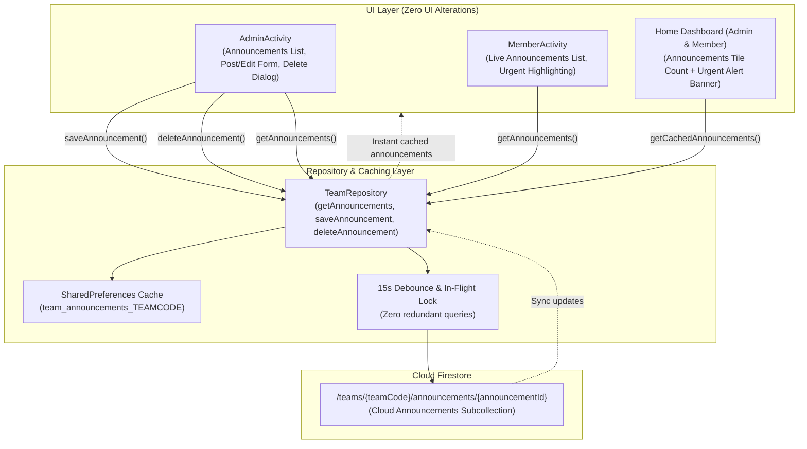

# Design Spec: Group 5 — Team Announcements & Urgent Alerts

**Date:** 2026-10-18  
**Status:** Approved by User / Ready for Implementation Plan  
**Package:** `com.example.syncedn.data` and `com.example.syncedn`  
**Target Branch:** `Backend`

---

## 1. Overview & Objective

Sa kasalukuyang implementasyon ng Synced N:
- Sa `AdminActivity.kt` at `MemberActivity.kt`, ang `announcementsView()` at `announcementEditView()` ay gumagamit lamang ng local SharedPreferences: `preferences.getString("leaderPosts", "[]")`.
- Dahil dito:
  1. Ang mga anunsyo ay lokal lamang sa device kung saan ito ginawa; hindi ito natatanggap o nababasa ng mga miyembro ng ministry sa kani-kanilang sariling telepono.
  2. Walang paraan ang Team Leader na burahin (`delete`) o i-edit ang isang nai-post nang anunsyo kapag kailangan itong alisin o i-update.
  3. Ang `urgent` toggle ("Mark as Urgent Alert") ay hindi nagti-trigger ng visual notification o prominent banner sa Home dashboard kung saan madalas tumitingin ang mga miyembro.

### Pangunahing Layunin (Group 5 Goals):
1. **Cloud Firestore Subcollection Architecture:**
   I-save at i-synchronize ang lahat ng team announcements sa:
   `/teams/{teamCode}/announcements/{announcementId}`
2. **Comprehensive Announcement Model (`AnnouncementData`):**
   Ang bawat announcement document ay naglalaman ng:
   - `id: String` (natatanging ID, e.g. `ann_timestamp` o Firestore key)
   - `teamCode: String` (6-character team invite code)
   - `title: String` (pamagat ng anunsyo)
   - `message: String` (buong nilalaman/detalye)
   - `urgent: Boolean` (tanda kung kritikal/urgent alert)
   - `author: String` (pangalan ng nag-post, e.g. "RYAN LLOYD")
   - `createdBy: String` (Firebase Auth UID ng leader)
   - `createdAt: Long` (timestamp kung kailan ginawa)
   - `updatedAt: Long` (timestamp kung kailan huling binago)
3. **Multi-Tier Caching & Offline Resiliency:**
   - SharedPreferences offline fallback cache key: `team_announcements_<teamCode>`.
   - In-memory debouncing (15-segundong cooldown katulad ng services at songs) upang maiwasan ang redundant reads sa Firestore.
   - Sorting: Default descending sort ayon sa `createdAt` (ang pinakabagong anunsyo ang unang lilitaw sa itaas).
4. **Leader Lifecycle Management (Publish, Edit, Delete):**
   - Sa `AdminActivity.kt`, ang bawat anunsyo ay may options menu (⋮) para sa **Edit** at **Delete** (may confirmation dialog bago tuluyang burahin sa Firestore).
   - Ang `announcementEditView()` ay susuporta sa parehong paglikha ng bagong post at pag-edit ng kasalukuyang post.
5. **Prominent Urgent Alert Banner sa Home Dashboard:**
   - Sa parehong `AdminActivity` at `MemberActivity` `homeView()`, kung may anunsyong `urgent == true`, magpapakita ng sleek at eye-catching **🚨 Urgent Alert Banner** sa itaas ng dashboard na may direktang tap action papunta sa `announcements` page.
6. **Robust Cloud Firestore Security Rules:**
   - Bagong domain validator function: `isValidAnnouncement()`.
   - Read access para sa lahat ng lehitimong miyembro ng parehong team (`isSameTeam(teamCode)`).
   - Create, Update, Delete access na eksklusibo lamang para sa verified Team Leader (`isLeaderOfTeam(teamCode)`).
7. **Strict Zero UI Disruption & Layout Integrity:**
   - Panatilihin ang lahat ng kasalukuyang kulay (navy `#0D1B2A`, purple `#6C4AB6`, deep dark backgrounds, card corners, 6dp button margins, at spacing).

---

## 2. Architecture & Data Flow



---

## 3. Data Model (`com.example.syncedn.data.model.AnnouncementData`)

### 3.1 `AnnouncementData.kt`
```kotlin
package com.example.syncedn.data.model

import com.google.firebase.Timestamp

data class AnnouncementData(
    val id: String = "",
    val teamCode: String = "",
    val title: String = "",
    val message: String = "",
    val urgent: Boolean = false,
    val author: String = "",
    val createdBy: String = "",
    val createdAt: Long = System.currentTimeMillis(),
    val updatedAt: Long = System.currentTimeMillis()
) {
    fun toMap(): Map<String, Any> {
        val map = mutableMapOf<String, Any>(
            "id" to id,
            "teamCode" to teamCode,
            "title" to title,
            "message" to message,
            "urgent" to urgent,
            "author" to author,
            "createdBy" to createdBy,
            "createdAt" to createdAt,
            "updatedAt" to updatedAt
        )
        return map
    }

    companion object {
        fun fromMap(map: Map<String, Any?>): AnnouncementData {
            fun parseTime(value: Any?): Long {
                return when (value) {
                    is Number -> value.toLong()
                    is Timestamp -> value.toDate().time
                    is String -> value.toLongOrNull() ?: System.currentTimeMillis()
                    else -> System.currentTimeMillis()
                }
            }

            return AnnouncementData(
                id = (map["id"] as? String).orEmpty(),
                teamCode = (map["teamCode"] as? String).orEmpty(),
                title = (map["title"] as? String).orEmpty(),
                message = (map["message"] as? String).orEmpty(),
                urgent = (map["urgent"] as? Boolean) ?: false,
                author = (map["author"] as? String).orEmpty(),
                createdBy = (map["createdBy"] as? String).orEmpty(),
                createdAt = parseTime(map["createdAt"]),
                updatedAt = parseTime(map["updatedAt"])
            )
        }
    }
}
```

---

## 4. Cloud Firestore Security Rules

Sa `firestore.rules`:

### 4.1 Domain Validator `isValidAnnouncement`
```javascript
function isValidAnnouncement(data, announcementId, teamCode) {
  return hasOnlyAllowedFields(data, [
    'id', 'teamCode', 'title', 'message', 'urgent', 'author',
    'createdBy', 'createdAt', 'updatedAt'
  ]) &&
  hasRequiredFields(data, ['id', 'teamCode', 'title', 'message', 'createdBy']) &&
  data.id is string && data.id == announcementId &&
  data.teamCode is string && data.teamCode == teamCode &&
  data.title is string && data.title.size() > 0 && data.title.size() <= 120 &&
  data.message is string && data.message.size() > 0 && data.message.size() <= 2000 &&
  data.urgent is bool &&
  (!('author' in data) || (data.author is string && data.author.size() <= 100)) &&
  data.createdBy is string && data.createdBy.size() > 0 &&
  (!('createdAt' in data) || (data.createdAt is number && data.createdAt >= 0) || (data.createdAt is timestamp)) &&
  (!('updatedAt' in data) || (data.updatedAt is number && data.updatedAt >= 0) || (data.updatedAt is timestamp));
}
```

### 4.2 Subcollection Rule: `/teams/{teamCode}/announcements/{announcementId}`
```javascript
// ---------------------------------------------------------------
// Subcollection: Announcements (/teams/{teamCode}/announcements/{announcementId})
// ---------------------------------------------------------------
match /announcements/{announcementId} {
  // Read: Lahat ng lehitimong miyembro ng team ay maaaring magbasa ng anunsyo.
  allow read: if isAuthenticated() && isSameTeam(teamCode);

  // Write: Tanging ang verified Team Leader ang may karapatang mag-post, mag-edit, o magbura.
  allow create: if isLeaderOfTeam(teamCode) &&
                   isValidAnnouncement(request.resource.data, announcementId, teamCode) &&
                   request.resource.data.createdBy == request.auth.uid;

  allow update: if isLeaderOfTeam(teamCode) &&
                   isValidAnnouncement(request.resource.data, announcementId, teamCode) &&
                   areImmutableFieldsUnchanged(['id', 'teamCode', 'createdBy', 'createdAt']);

  allow delete: if isLeaderOfTeam(teamCode);
}
```

---

## 5. Repository Layer (`TeamRepository.kt`)

Idadagdag ang sumusunod na mga methods sa `TeamRepository`:

1. **`getCachedAnnouncements(teamCode: String, preferences: SharedPreferences?): List<AnnouncementData>`**:
   - Agad na nagbabalik ng data mula sa memory cache o SharedPreferences key `cached_announcements_${teamCode}`.
2. **`saveAnnouncementsLocally(teamCode: String, list: List<AnnouncementData>, preferences: SharedPreferences?)`**:
   - Naka-serialize bilang JSON string sa SharedPreferences para sa instant offline startup.
3. **`getAnnouncements(teamCode: String, forceRefresh: Boolean, preferences: SharedPreferences?, onResult: (Result<List<AnnouncementData>>) -> Unit)`**:
   - May 15-second debounce check gamit ang `lastAnnouncementsFetchTimestamp`.
   - Kumukuha mula sa `teams/{teamCode}/announcements` ordered by `createdAt` descending.
4. **`saveAnnouncement(teamCode: String, announcement: AnnouncementData, preferences: SharedPreferences?, onComplete: ((Result<AnnouncementData>) -> Unit)?)`**:
   - Local-first optimistic cache update bago mag-Firestore `.set(..., SetOptions.merge())`.
5. **`deleteAnnouncement(teamCode: String, announcementId: String, preferences: SharedPreferences?, onComplete: ((Result<Boolean>) -> Unit)?)`**:
   - Inaalis sa local cache bago mag-Firestore `.delete()`.

---

## 6. UI Implementation Details

### 6.1 `AdminActivity.kt`
- **`announcementsView()`**:
  - Nag-trigger ng `TeamRepository.getAnnouncements(activeCode)`.
  - Ipinapakita ang live announcements gamit ang existing `panel()` styling.
  - May `⋮` button sa kanang itaas ng bawat announcement panel:
    - Popup options: **"Edit"** at **"Delete"**.
    - "Delete" nagpapakita ng confirmation dialog bago tawagin ang `TeamRepository.deleteAnnouncement()`.
- **`announcementEditView()`**:
  - Tumatanggap ng parameter para sa editing mode (`editingAnnouncementId: String?`).
  - Pre-filled ang Title, Message, at Urgent Checkbox kapag nag-e-edit.
  - Sa click ng "Publish": gumagawa o nag-a-update ng `AnnouncementData`, tumatawag sa `TeamRepository.saveAnnouncement()`, at bumabalik sa `announcements`.
- **`homeView()` & `announcementHomeTile()`**:
  - Nagpapakita ng dynamic count ng live announcements (e.g., `3 announcements`).
  - Kung mayroong kahit isang active announcement na `urgent == true`:
    - Nagre-render ng **🚨 Urgent Alert Banner** sa itaas na may red/purple gradient border, icon, pamagat, at tap action na nagbubukas ng `announcements`.

### 6.2 `MemberActivity.kt`
- **`announcementsView()`**:
  - Live announcements list mula sa `TeamRepository.getAnnouncements(activeCode)`.
  - Read-only para sa member.
  - Kapag `urgent == true`: May prominent alert tag/badge at distinct border.
- **`homeView()`**:
  - Nagre-render din ng **🚨 Urgent Alert Banner** kapag may active urgent alert mula sa leader.

---

## 7. Verification & Testing Plan

1. **Unit Testing (`ExampleUnitTest.kt`)**:
   - `testAnnouncementDataSerializationAndDeserialization`: Sinusuri ang `toMap()` at `fromMap()` kasama ang timestamp parsing at default values.
   - `testTeamRepositoryAnnouncementCaching`: Sinusuri ang local caching, memory debounce, at sorting (pinakabago sa unahan).
2. **Security Rules Deployment & Verification**:
   - I-compile at i-deploy ang rules gamit ang `firebase deploy --only firestore:rules`.
3. **Live Emulator Testing (`emulator-5554`)**:
   - Mag-post ng announcement bilang Leader (na may Urgent checked).
   - I-verify na lumitaw ito sa Announcements view at sa Home dashboard Urgent Alert Banner.
   - I-edit ang announcement at i-verify ang update.
   - I-login ang Member account at tiyaking nababasa ang parehong announcement at nakikita ang Urgent Alert Banner.
   - I-delete ang announcement at tiyaking nawala ito sa parehong Leader at Member devices.
